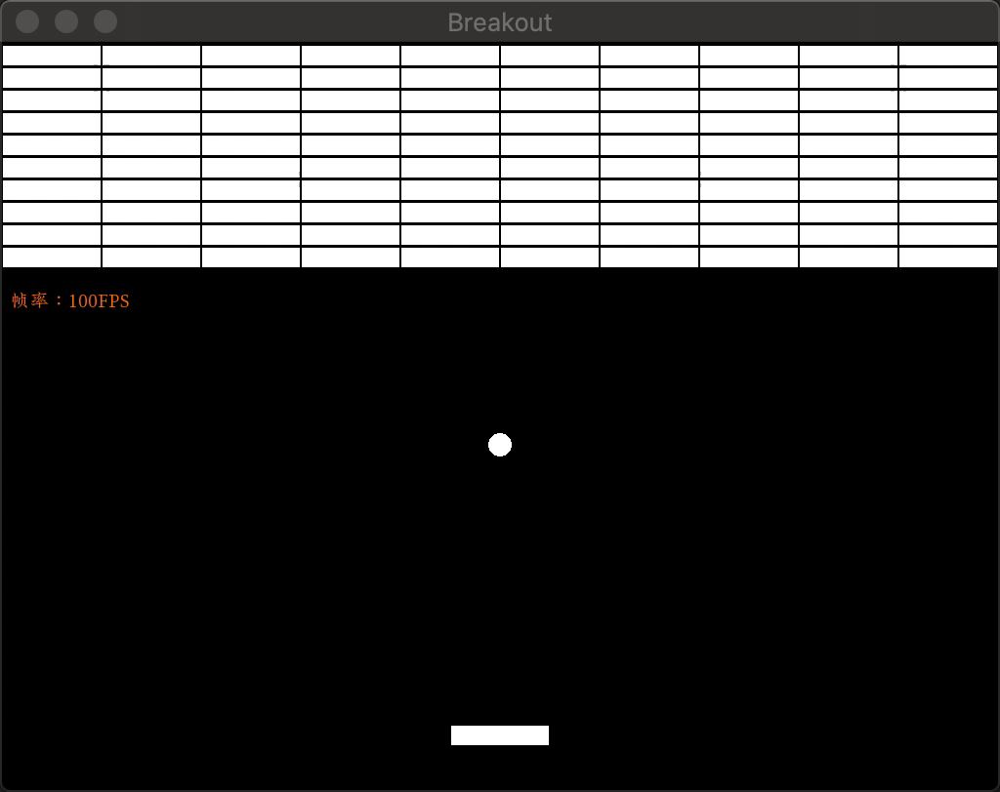
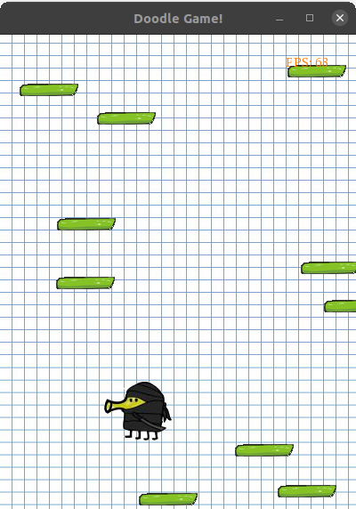
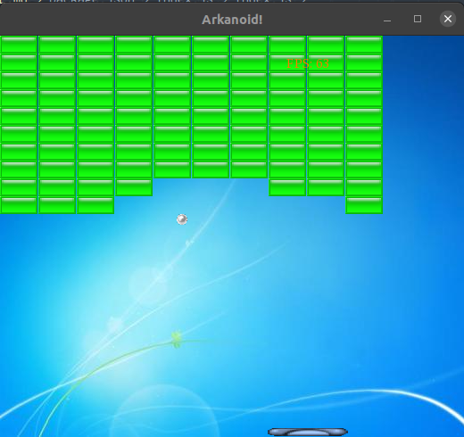

<h1 align="center">node-sfml-demos</h1>

<p align="center">
  Five desktop games. JavaScript. Native windows.<br>
  Built with <a href="https://sfml.js.org/">sfml.js</a> · <code>1.0.0-rc.2</code> · SFML 3.1.0
</p>

<p align="center">
  <a href="#quick-start">Quick start</a> ·
  <a href="#games">Games</a> ·
  <a href="#notes">Notes</a>
</p>

## Quick start

```sh
git clone https://github.com/XadillaX/node-sfml-demos.git
cd node-sfml-demos/bomberman
npm install
node index.js
```

Choose any game folder below and run `npm install`, then `node index.js` inside it. Each demo installs its own dependencies, with **sfml.js pinned to rc2**. Keep the full repository: some demos share fonts and textures.

<details>
<summary><strong>Build requirements</strong> — Node.js, Python and a C++ compiler</summary>

Use **Node.js 22**, Python 3 and a C++20 toolchain. Installation downloads the matching SFML libraries and compiles the native addon.

| Platform | Toolchain |
| --- | --- |
| macOS 13+ | Xcode Command Line Tools (`xcode-select --install`) |
| Linux x64 | GCC or Clang, make, X11, OpenGL and audio development libraries |
| Windows | Visual Studio 2022 Build Tools with Desktop development with C++ |

See the [installation guide](https://github.com/XadillaX/node-sfml/blob/v1.0.0-rc.2/docs/getting-started.md#requirements) for platform-specific commands. Run in a graphical desktop session; Bomberman also uses audio.

</details>

## Games

[Bomberman](#bomberman) · [Breakout](#breakout) · [Tetris](#tetris) · [Doodle Jump](#doodle-jump) · [Arkanoid](#arkanoid)

### Bomberman

Two players, one keyboard. A JavaScript port of [PiGames/Bomberman](https://github.com/PiGames/Bomberman), preserving the original C++ module structure.

<p align="center">
  
</p>

**Folder:** [`bomberman/`](bomberman)

| Player 1 | Player 2 | Menu |
| --- | --- | --- |
| WASD · Left Ctrl to place a bomb | Arrow keys · Space to place a bomb | Mouse · Esc to pause/resume |

### Breakout

Clear the bricks against a starry backdrop.

<p align="center">
  
</p>

**Folder:** [`breakout/`](breakout)<br>
**Controls:** A/D or Left/Right to move and launch; Space also launches. Release Space after losing to reset. Esc exits.

### Tetris

Stack and clear falling blocks. Adapted from [jsyqrt/games — Tetris](https://github.com/jsyqrt/games/blob/master/01%20Tetris/main.cpp).

<p align="center">
  
</p>

**Folder:** [`tetris/`](tetris)<br>
**Controls:** Left/Right to move · Up to rotate · Down to drop faster.

### Doodle Jump

Jump from platform to platform. Adapted from [jsyqrt/games — Doodle Jump](https://github.com/jsyqrt/games/blob/master/02%20Doodle%20Jump/main.cpp).

<p align="center">
  
</p>

**Folder:** [`doodle_jump/`](doodle_jump)<br>
**Controls:** Left/Right to move. Jumping is automatic.

### Arkanoid

A compact brick breaker, adapted from [jsyqrt/games — Arkanoid](https://github.com/jsyqrt/games/blob/master/03%20Arkanoid/main.cpp).

<p align="center">
  
</p>

**Folder:** [`arkanoid/`](arkanoid)<br>
**Controls:** Left/Right to move the paddle. The ball starts automatically.

## Notes

All games support the window's close button. Previews above are from the original demos. Tetris, Doodle Jump and Arkanoid retain the original prototypes' incomplete gameplay.

## License

[MIT](LICENSE). Original projects are credited with each game; retain their attribution when reusing the ports and assets.
